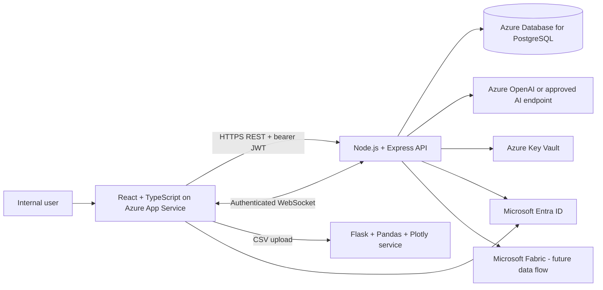

# Architecture

Locally, React runs on 5173, the API/WebSocket server on 3000, PostgreSQL on 5432, and analytics on 5000. Locally the demo uses a mock JWT login; the Azure design uses Entra ID. The diagram is a target design, not a claim that Azure resources were deployed.

## Request flow

1. User signs in and receives a short-lived JWT.
2. React sends API requests with `Authorization: Bearer <token>`.
3. Express authentication middleware validates the signature and expiration.
4. Zod validates request bodies; a service applies business rules; a repository calls Prisma.
5. Prisma queries PostgreSQL. When shipment status changes, the API broadcasts the event to authenticated WebSocket clients.
6. The separate Flask service reads uploaded CSV data with Pandas and returns summary statistics and Plotly chart HTML.
