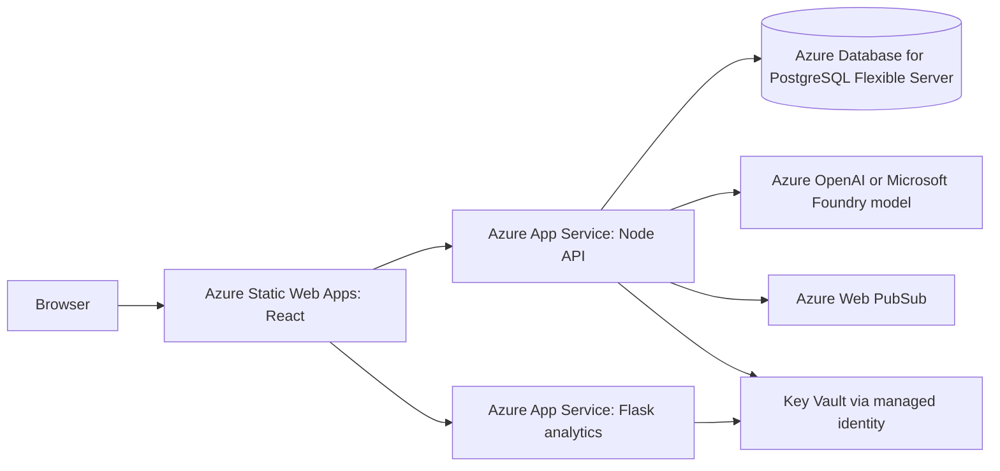

# Azure deployment plan

## Status

This is a deployment plan. No Azure resources have been created and the app is not deployed. A working Azure subscription is required. Review the region-specific prices and set a budget before provisioning resources; a free-account offer does not guarantee every resource or use will be free.

## Suggested architecture

- **Frontend:** Azure Static Web Apps serves the Vite production build. Set `VITE_API_URL` and `VITE_ANALYTICS_URL` at build time.
- **API:** Azure App Service for Linux runs the Node/Express service. Configure `PORT`, `FRONTEND_ORIGIN`, `DATABASE_URL`, and a strong `JWT_SECRET` through App Service settings or Key Vault references.
- **Analytics:** a separate Linux App Service runs Flask with Gunicorn. Set `PORT` and `FRONTEND_ORIGIN`; the app supports those environment variables.
- **Database:** Azure Database for PostgreSQL Flexible Server stores customers and shipments. Prefer private networking for a production deployment.
- **Secrets and identity:** use App Service managed identity to read secrets from Key Vault. Replace the single local demo login with Microsoft Entra ID before real users access the app.
- **AI:** the local Ollama instance is on the developer's computer and cannot serve an Azure-hosted app. Configure Azure OpenAI or a Microsoft Foundry model deployment for a hosted demo. The current Azure OpenAI path uses a key, which must be kept in Key Vault; managed identity would require an additional code change.
- **Live updates:** the current WebSocket server holds connections in memory and suits one API instance. Use Azure Web PubSub for managed fan-out if the app is scaled to multiple instances.

## Deployment sequence

1. Choose a subscription, region, naming convention, and monthly budget. Put all demo resources in one resource group.
2. Create the Static Web App, Node App Service, Flask App Service, PostgreSQL server, and Key Vault. Add Web PubSub only if the live-update feature is being hosted.
3. Configure HTTPS, CORS origins, application settings, managed identity permissions, and database firewall/private-network rules.
4. Build and deploy the backend and analytics app. Configure Flask's startup command to run Gunicorn, for example `gunicorn --bind 0.0.0.0:$PORT app:app`.
5. Build the frontend with the deployed API and analytics URLs; deploy the `frontend/dist` output.
6. Apply the reviewed Prisma migrations to the Azure database. Do not point the local app at production data during the demo.
7. Check `/health` on both services, sign in with the chosen identity setup, create a sample customer and shipment, upload the sample CSV, and check the logs.
8. After the demo, stop or delete the resource group and check Cost Management for any remaining resources.

## Cost and cleanup

The main recurring charges are the App Service hosting plans, PostgreSQL compute/storage/backups, Key Vault operations, optional Web PubSub, and any hosted AI model usage. Prices vary by region, SKU, storage, and account offer. Use the [Azure pricing calculator](https://azure.microsoft.com/en-us/pricing/calculator/) and check the [PostgreSQL Flexible Server pricing page](https://azure.microsoft.com/en-us/pricing/details/postgresql/flexible-server/) for the selected region before creating resources. Azure's [free account offer](https://azure.microsoft.com/en-us/pricing/purchase-options/azure-account/) has eligibility and usage limits; verify them in the account.

## Current limitations to explain

- This project is currently local-only; the plan above is not a deployment claim.
- The demo's JWT login is not Entra ID authentication.
- Chat conversations and WebSocket client lists are held in memory.
- The local AI provider is Ollama; Azure needs a reachable hosted model endpoint.
- SharePoint announcements return sample data. A live integration needs a tenant, Microsoft Graph permissions, and managed identity or another approved server-side credential flow.

## Microsoft references

- [Deploy a React app on Azure Static Web Apps](https://learn.microsoft.com/en-us/azure/static-web-apps/deploy-react)
- [Deploy a Node.js app on Azure App Service](https://learn.microsoft.com/en-us/azure/app-service/quickstart-nodejs)
- [Deploy a Flask app on Azure App Service](https://learn.microsoft.com/en-us/azure/app-service/quickstart-python)
- [App Service managed identities](https://learn.microsoft.com/en-us/azure/app-service/overview-managed-identity)
- [Azure Web PubSub](https://learn.microsoft.com/en-us/azure/azure-web-pubsub/)
