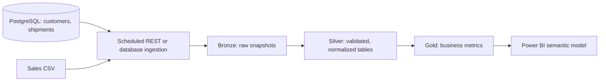

# Microsoft Fabric readiness

## Current status

The demo does not connect to a Fabric workspace. This design describes how its operational and sales data could be prepared for Fabric without claiming that a lakehouse or pipeline has been deployed.

## Suggested flow

## Data layers

| Layer | Example contents | Example checks |
| --- | --- | --- |
| Bronze | Dated, unchanged extracts from customers, shipments, and sales CSVs | Record source, extract time, and file name |
| Silver | Clean customer, shipment, and sales tables | Normalize status/date values, validate required columns, remove duplicate IDs, and mark soft-deleted customers |
| Gold | Shipment counts by status, delivery duration, revenue by region, and sales by salesperson | Agree on metric definitions and refresh time with business users |

## Suggested model

- `dim_customer`: customer ID, company, status, active flag.
- `fact_shipment`: shipment ID, customer ID, created date, status, origin, and destination.
- `fact_sales`: salesperson, region, sales date if available, and revenue.
- Keep direct customer names and emails out of gold reporting tables unless a report truly needs them.

## Ingestion and refresh

For an initial demo, copy the supplied sales CSV to a Bronze files area and use a Fabric Data Factory pipeline or notebook to validate and transform it. For operational data, use a scheduled extraction from the API or a supported PostgreSQL connector. Use an update timestamp or a periodic snapshot so changed shipment statuses and soft deletions are represented. Store service credentials in Microsoft Entra-backed connections or a managed identity; do not put secrets in notebooks or files.

## How to explain it

“The project currently uses PostgreSQL for live application data and a CSV for sales analytics. To make it Fabric-ready, I would land source data unchanged in Bronze, clean and validate it in Silver, and publish reporting tables in Gold for Power BI. Fabric is a proposed integration here; this demo is not connected to a Fabric workspace.”

Microsoft's Fabric guidance describes Bronze, Silver, and Gold as increasing-quality layers in OneLake: [Medallion lakehouse architecture](https://learn.microsoft.com/en-us/fabric/onelake/onelake-medallion-lakehouse-architecture).
