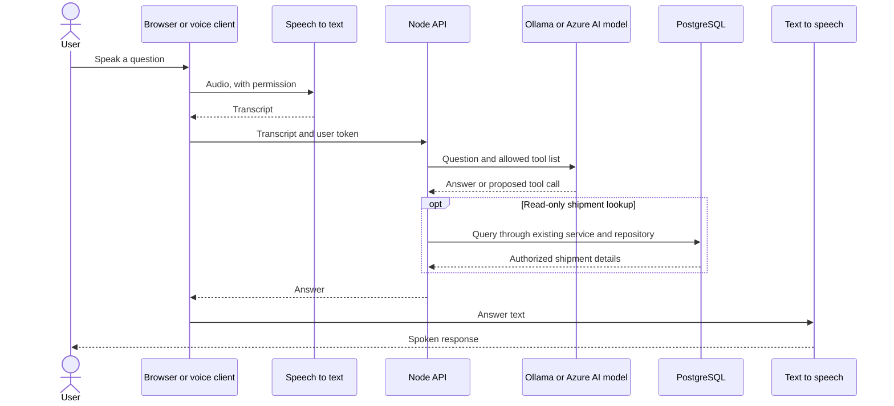

# Voice assistant architecture

## Current status

The assessment app has a text chat page. It does not currently record or play audio. The applicant's separate Nova project uses Python, SoundDevice, SpeechRecognition, and a local Ollama/Llama model; that experience can inform a future voice interface for this operations app.

## Proposed flow

## Safety and access rules

1. Request microphone permission only after the user chooses voice mode and show when recording is active.
2. Send the authenticated user's token to the backend. Enforce the same customer/shipment permissions as the website.
3. Let the model request only named backend tools, such as `getShipmentStatus`. Never give the model direct database access or arbitrary shell commands.
4. Require a clear user confirmation before any write action, such as changing a shipment status.
5. Validate every tool argument in the API and record the action result. Avoid storing raw audio; keep transcript retention limited and visible to the user.
6. If speech recognition or the model fails, show the transcript and allow the user to continue with text.

## Local and Azure options

- Local prototype: use the existing Nova speech capture and SpeechRecognition path with Ollama/Llama. Keep voice processing on the user's machine where practical.
- Azure-hosted version: use Azure AI Speech for recognition/speech output and a deployed model in Microsoft Foundry or Azure OpenAI. The local Ollama process on a laptop is not reachable by an Azure-hosted app.
- Keep the voice client separate from the operations API. The API remains the trusted place for authentication, validation, permission checks, and database changes.

## How to explain it

“My resume project already has a local voice-agent prototype. For this assessment, the assistant is text-only. A future voice client could convert speech to text, call the same protected API, and speak the answer. The model would not access PostgreSQL directly, and any status change would need confirmation.”
